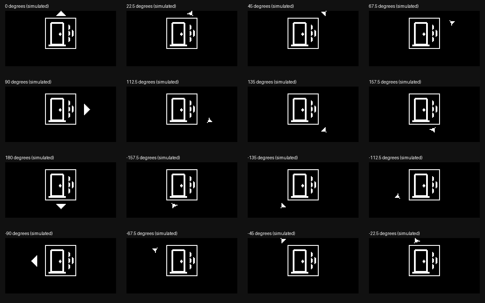

# Display directions: 16 positions, same Pi renderer

The centered icon and priority box stay stationary. A filled triangle indicates a bearing rounded
to one of 16 positions, 22.5 degrees apart. 0 is front, +90 right, 180 behind, -90 left. This is
presentation granularity, not a claim of 22.5-degree microphone accuracy. Unknown/low-confidence
direction still has no triangle. The original four cardinal triangles are unchanged.

`/display` optionally includes `bearing_degrees` (-180..180) alongside the existing coarse `direction`.
The receiver supplies it only when direction passes the existing confidence gate. Legacy packets
with only `direction` still render the original four arrows. Both renderers use baked coordinates
in hardware/oled-assets.json: no runtime trigonometry, model or numerical library is needed on Pi.
Existing look-to-resolve semantics still use the four coarse sectors.

Use Live → Test a direction or sequence → Simulated bearing to pick all 16 positions, then play a
mock sound. This does not attach simulated directions to real microphone detections. Name events
currently have no spatial direction. The mock selector returns to No direction after our check.

## Deployment boundary

| Computer | Runs |
| --- | --- |
| Mac | Audio model, name detection, optional phone bridge, event/priority receiver, web companion |
| Original Raspberry Pi Zero W | hardware/display.py, hardware/oled_client.py, hardware/__init__.py, hardware/oled-assets.json; smbus2 to drive SSD1306 |

scripts/glasses_up.sh explicitly copies only those display runtime files and an optional smbus2
wheel. It does not copy audio/, model weights, the website, native phone app or the entire checkout.
Do not install requirements-audio.txt on the Pi. On a reachable Pi, scripts/glasses_up.sh live copies
the runtime and connects the OLED to the Mac receiver over the existing SSH reverse tunnel.

The Pi was unreachable at glasses-pi.local during this update; the new runtime has not been copied
or exercised physically. Test through the optics after deployment; 16 tiny positions may be harder
to distinguish than four. Current snap recognition is explicitly parked/off per Emma; manual
Dismiss, optional phone-camera thumbs-up and sustained-quiet alarm clearing remain available.

## Verification

93 Python tests, 21 frontend tests and production build pass. Shared render fixtures include all
16 bearings with labels on/off and are checked byte for byte by the browser tests. Tests cover
unique masks, no overlap with icon/tier box, exact old cardinal frames, -180/180 wrap, invalid inputs
and low-confidence gating. Live website mock knock carried 22.5 degrees with source=mock and showed
the matching arrow. This is software evidence, not a physical localization or optics trial.
