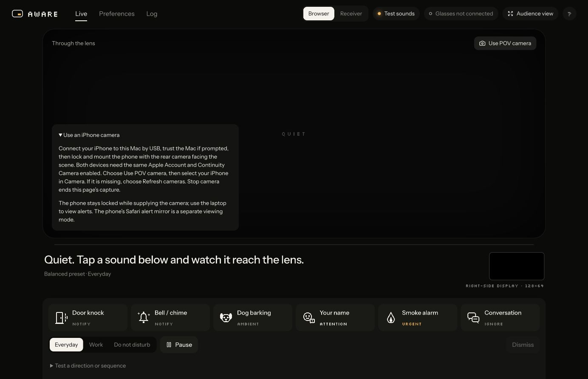

# iPhone → laptop simulator POV

Chosen path: Apple Continuity Camera. Emma confirmed the iPhone and simulator Mac use the same
Apple Account. No browser-to-browser streaming server, certificate, public tunnel or phone app is
needed. This is a camera for the demo POV; the physical glasses still have no camera.

## Connect

1. On iPhone, check Settings → General → AirPlay & Continuity (or AirPlay & Handoff) → Continuity Camera.
2. Keep Wi-Fi and Bluetooth on for both devices. Connect the iPhone to the Mac with a data-capable
   USB cable (USB-C to USB-C is fine for a USB-C iPhone; it must carry data, not charge only). If the phone asks to trust this Mac, complete that yourself.
3. Lock the phone, mount it securely in landscape, and point its rear camera at the scene.
4. On the **Mac**, open the Aware companion → Live → Use POV camera. Allow camera access there.
5. In the Camera selector, choose the iPhone. If it appears after capture starts, the list refreshes
   on device changes; Refresh cameras is also available. If absent, check the Apple setup above.
6. Use Receiver mode for shared live alerts. The camera is a backdrop; audio classification still
   comes from the processing Mac's separately configured capture/model process.

The iPhone Safari alert viewer is a **separate mode**. Continuity Camera expects the phone locked;
do not plan to keep its Safari viewer visible on the same phone while it supplies the camera.
Use the laptop/audience view, or a second phone for the alert viewer.

## Privacy and lifecycle

The page requests video only (`audio: false`), does not record it, and draws the stream locally.
It doesn't switch the audio pipeline to the iPhone microphone. Stop camera or leaving Live releases
this page's tracks. Switching cameras stops the previous tracks after the replacement opens.
Disconnecting the selected camera clears its stream and shows a reconnect message.
Gestures remain optional and finicky; leave them off for this camera connection test.

## Acceptance check (physical trial pending)

- Confirm the selected device is the iPhone, not the built-in Mac camera.
- Move a hand/object in front of the iPhone rear camera; it should appear on the laptop.
- Send a receiver mock alert and verify the exact OLED cue overlays the moving scene.
- Dismiss on the laptop; verify its check acknowledgement, then idle.
- Unplug/disconnect the camera; verify clear error and reconnect/selection behavior.
- Stop camera; verify the camera indicator/stream ends. Test Audience view separately because
  switching views remounts the stage and intentionally ends that page capture.

Software build and UI help verified. Emma confirmed the physical iPhone camera works after connecting via USB and selecting it on the Mac. Disconnect/reconnect and full combined audio/video trials remain pending. No claim that actual iPhone capture has passed until Emma tests.
If the Codex in-app browser does not expose the iPhone camera, try the companion localhost URL in
Safari/Chrome on the Mac and allow camera access in that browser. Keep a laptop webcam fallback.

Source: [Apple Continuity Camera requirements and setup](https://support.apple.com/en-us/102546).




## iPhone microphone → audio model

Continuity Camera exposes its microphone separately from video. Selecting the iPhone camera does not
change the audio model's input. Emma's Mac currently lists `0 Emma Microphone` and
`1 MacBook Pro Microphone`; device indices can change after reconnect/restart, so enumerate again:

```sh
.venv/bin/python -m audio.cli devices
```

The listed Emma Microphone advertises 16 kHz mono float32 support (checked without capturing audio).
Confirm it is the intended iPhone input before a live trial. The model runs on the Mac; the phone
only supplies capture. To run a bounded, explicitly authorized 30-second test against Emma's current
receiver on 8766:

```sh
.venv/bin/python -m audio.cli --model zipformer mic --device 0 --seconds 30 --endpoint http://127.0.0.1:8766/events --debug
```

Use Receiver mode on the companion. This command starts listening, may request macOS microphone
permission, writes score/decision logs locally, and does not save raw audio. Ctrl+C stops early.
The receiving Mac still needs the model dependencies and cached weights. John's custom-sound
extension is not yet integrated into this branch. Phone microphone capture does not validate the
synchronized two-microphone spatial pipeline intended for the glasses.
