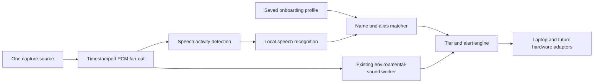

# B — Name detection implementation plan

Status: **implemented with a different recognizer**: see [name-detection.md](name-detection.md). The
build uses the sherpa-onnx Zipformer keyword spotter (streaming, same library as the sound model) instead
of whisper.cpp, plus optional learned spellings recorded during onboarding. This plan is kept for context.

## Relationship to onboarding

Name detection **consumes the saved onboarding profile**: typed primary name, optional aliases,
language, and enable/disable preference. The same profile also contains notification preferences.
Onboarding writes that profile; the recognition worker reads it. No spoken enrollment or per-user
model training is required for this approach.

The first implementation can read a local JSON profile, so recognition can be built and tested
before the onboarding website exists. When the website is added, it saves the same contract.
See [proposed profile example](onboarding-profile.example.json). This is a proposed interface,
not an existing settings endpoint or a profile already loaded by the current app.

Proposed behavior:

- Primary name defaults to the typed onboarding name; aliases are optional, explicitly entered names,
  nicknames, or validated transcription spellings. Do not invent acoustic variants automatically.
- Missing/empty name or disabled name detection turns off only this worker; sound classification continues.
- Edits increment `revision`. Jobs carry a profile revision; discard stale name detections after a change.
- Store the profile locally with atomic replacement. A future loopback `PUT /profile` endpoint validates
  updates and persists them; the onboarding UI uses that endpoint. No backend or UI endpoint is built yet.
- Validate names as Unicode text, trim whitespace, reject empty aliases/control characters, and bound
  the alias count/length. Preserve accents and the user's original display spelling.

## Proposed processing path



Refactor capture into a shared source before adding the speech worker. Do not open the microphone twice.
Both workers get timestamped 16 kHz mono samples from bounded queues. Preserve original multichannel
capture separately if future localization needs it. Speech processing must not block sound alerts.
When a queue falls behind, report drops/reset the segment rather than silently processing stale audio.

Candidate: **whisper.cpp** with `base.en` for the first English benchmark on this Apple Silicon Mac.
Compare `small.en` if name accuracy is inadequate; choose a multilingual model if the configured language
requires one. Keep the model loaded in a long-lived worker. This is an initial choice to evaluate,
not a performance claim. The project documents Apple Silicon/Metal support and optional Silero VAD.
Sources: [whisper.cpp](https://github.com/ggml-org/whisper.cpp),
[VAD documentation](https://github.com/ggml-org/whisper.cpp#voice-activity-detection-vad).

Use speech activity detection with pre-roll and trailing padding so a short name is not cut off.
Start with short finalized utterances; cap long segments and overlap their boundaries. Exact timing,
VAD thresholds, and model latency must be measured on the demo machine, including single-syllable names.
Do not promise true token streaming from a chunked speech recognizer.

## Matching and false-alert controls

1. Only process segments with speech evidence. Silence, alarms, and ringing are negative tests for ASR hallucinations.
2. Normalize Unicode and case, then tokenize names and transcripts consistently. Compare complete token
   sequences; `Ann` must not match `announcement`, and `Sam` must not match `Samsung`.
3. Match the configured name or an explicit alias. Fuzzy/phonetic matching stays off by default until
   similar-sounding negatives have been evaluated.
4. Emit once per utterance/segment. Use sample-range IDs and overlap deduplication; apply a short name-event cooldown.
5. Record alias ID and match reason in diagnostics. Do not store ambient transcripts or raw speech by default.

Typed name/aliases change the matching target, not the environmental model. Giving the name as an ASR
prompt may bias hallucinations; evaluate that separately before enabling it.

Detecting a name in conversation does not establish that someone is intentionally calling the wearer.
Use a neutral display label such as **Your name**. The internal proposed event is `name_called`, tier 3.

## Event contract changes required before implementation

The current receiver accepts environmental events only. Add the new type and update validation before
emitting it. ASR quality and environmental classification confidence are different quantities.
Do not use an exact text match as `confidence: 1.0`.

Proposed name event (schema v2), with unavailable confidence explicitly represented:

```json
{
  "schema_version": 2,
  "event_id": "uuid",
  "type": "name_called",
  "label": "Your name",
  "source": "replay",
  "recognizer": "whisper.cpp",
  "confidence": null,
  "confidence_kind": "unavailable",
  "matched_alias_id": "primary",
  "profile_revision": 1,
  "segment_id": "capture-session:16000-48000",
  "priority_tier": 3,
  "timestamp_ms": 1792800000000,
  "direction_degrees": null,
  "direction_confidence": null,
  "distance_meters": null,
  "proximity": "unknown"
}
```

The receiver should continue accepting v1 environmental events. The monitor needs a null-safe score
display for v2 name events. If the adapter exposes usable decoder quality, log its actual meaning
separately and tune rejection rules; it still must not be advertised as a calibrated correctness probability.

## Implementation order and reviewable deliverables

| Step | Deliverable | Acceptance check |
| --- | --- | --- |
| 1 | Profile loader/validation and shared audio fan-out | Missing profile leaves environmental alerts working; changed name replaces old aliases |
| 2 | Warm local ASR + VAD worker and replay input | Recorded speech produces segment output without delaying the environmental worker |
| 3 | Token matcher + overlap deduplication | Exact names/aliases match; substrings, unrelated names, repeated chunks, and stale revisions do not alert |
| 4 | v2 name event + neutral tier-3 cue | Event reaches the monitor, interrupts tiers 1–2, and cannot replace tier 4 |
| 5 | Labeled evaluation and latency log | Report measured name recall, false name alerts, and capture-to-display delay; preserve failure examples |

## Evaluation before claiming success

- Start with clearly labeled synthetic speech for wiring; evaluate real independent speakers before making voice-accuracy claims.
- Include the configured name alone, “hey NAME”, name at a sentence boundary, aliases, and a long utterance
  crossing a chunk boundary. Test multiple voices and quiet/noisy audio.
- Include similar names, common-word substrings, unrelated conversation, silence, music, bells, and smoke alarms.
- Include changed settings mid-segment, pause/resume, repeated utterances, and simultaneous name + critical alarm.
- Record counts and false alerts per minute of negative audio, not only accuracy on cherry-picked name clips.
- Proposed demo targets, not measured results: at least 90% quiet positive recall, at least 95% precision on
  the chosen test mix, no alerts on the silence/alarm fixtures, and one event per utterance.
- Rare/culturally diverse names may need explicit aliases or a stronger model. Report unsupported cases.

## C — Hardware adapter dependency

Hardware implementation starts after the stack is supplied. Needed facts: compute device/OS; controller;
microphone model/interface/channel count/sample rate; whether channels are synchronized; display model,
resolution and driver; audio transport; alert transport; and available dismiss/mute controls.
Then select one capture adapter and one display adapter while keeping the event contract stable.
