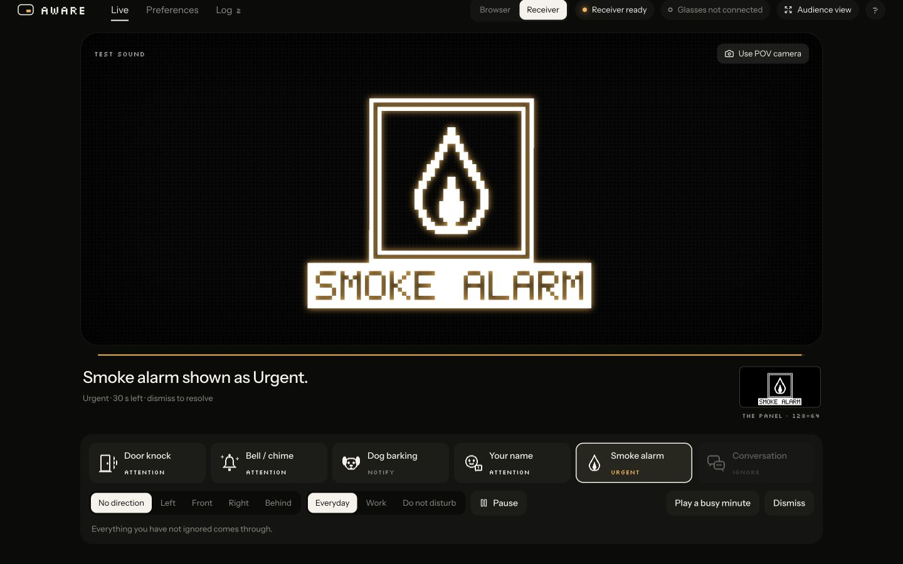
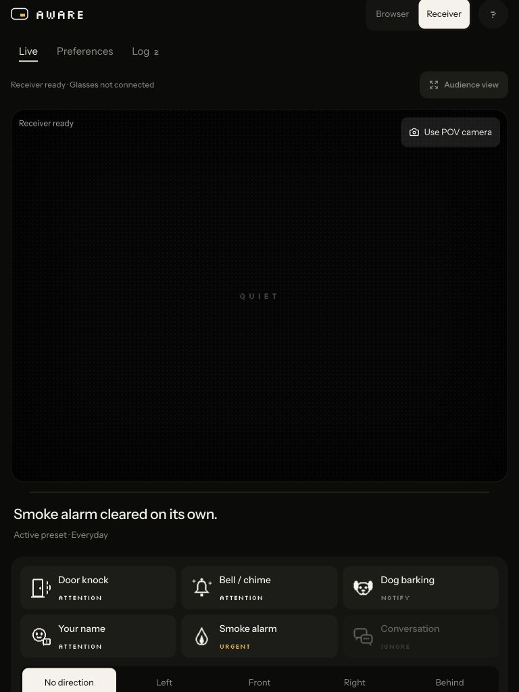
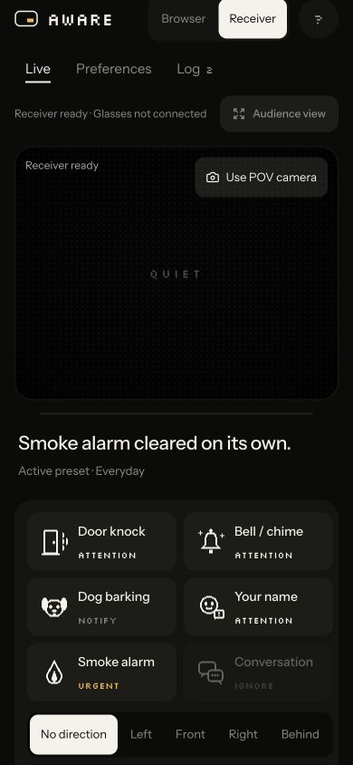

# Overnight software verification — October 24, 2026

Scope: Emma's simulator, display presentation, onboarding, tier backend and notification integration.
These are software and simulated-time checks. This is not a 52-hour wall-clock device soak, wearer
validation, recognition accuracy measurement, or proof that physical glasses work.

## Results

| Check | Result | Evidence |
| --- | --- | --- |
| Production frontend | Pass | TypeScript + Vite build |
| Frontend behavior tests | 15 pass | `npm test --prefix frontend` |
| Python suite | 41 pass | `python -m unittest discover -s tests -v`; includes local HTTP |
| Shared notification scenarios | 17 pass in both languages | `audio/alert-scenarios.json` |
| Seeded cross-language stress | 150,000 actions pass | 50,000 each, seeds 1 / 42 / 20261024; about 52 simulated hours total |
| Stress renderability | 150,000 frames | Exact 1024-byte output; no hardware accessed |
| Browser/Python raster parity | 127 fixture frames match byte for byte | Includes all icons/tiers, directions, labels, long and Unicode labels |
| Responsive live view | Reviewed at 390×844, 768×1024, 1440×900 | DOM scroll width equals viewport width; screenshots below |
| Keyboard | Arrow keys select segmented mode; Work holds Notify; Escape exits audience | Checked in the browser against isolated receiver |
| UI → profile → receiver | Pass | Active preset applied as receiver version 2; dog cue became Notify |
| Pause | Pass | Dismiss followed by Pause left no cue or confirmation visible |
| Disconnect/reconnect | Pass | Stopped isolated receiver during urgent cue; view cleared and controls disabled; restart reconnected without replay |
| Taste source lint | 0 FAIL, 1 intentional WARN | Browser-only OLED glow; full Taste inspector was not run |

The stress script also checks bounded queue/history, nonnegative remaining time and no visible cue,
confirmation or queued backlog while paused. Inputs include duplicate IDs, repeated sounds, stale
and valid dismissals, modes, pause, direction confidence and clock advances. It found a real tie-break
mismatch after 4,436 actions before that mismatch was fixed.

## Fixed in this pass

- Pause clears an in-progress resolution check mark as well as the alert.
- Equal-priority interruptions respect the queue limit, just like lower-priority arrivals.
- Queue ties choose the same first-arriving cue in Python and TypeScript.
- Invalid controls are rejected atomically; nonfinite look headings get HTTP 400.
- Separate receiver instances no longer share one HTTP handler's global state.
- Malformed receiver health/queue/lifetime/confirmation data produces a connection error rather than
  crashing the screen. Receiver label settings drive the mirror; resolution checks remain icon-only.
- Onboarding uses the same pixel renderer as the live screen, with simulated direction passed to both
  preview modes. Browser glow choices now affect the live preview; physical pixels remain white.
- Phone layouts retain connection status and Audience view; compact controls have larger touch targets.
- Audience view fills the viewport while preserving the panel's 2:1 aspect ratio.
- Non-ASCII labels use Unicode character counts consistently across Python and JavaScript. Unsupported
  font characters still render as `?`; this does not add a multilingual OLED font.
- The cross-language stress test runs in frontend CI. Changes to shared policy/hardware now trigger
  frontend checks too.

## Reproduce

```sh
npm ci --prefix frontend
npm run build --prefix frontend
npm test --prefix frontend
.venv/bin/python -m unittest discover -s tests -v
.venv/bin/python scripts/verify_alert_parity.py --steps 50000 --seed 1
.venv/bin/python scripts/verify_alert_parity.py --steps 50000 --seed 42
.venv/bin/python scripts/verify_alert_parity.py --steps 50000 --seed 20261024
```

No microphone/camera, models, cloud API keys or OLED are required for these checks. Python HTTP tests
need permission to bind temporary loopback ports in sandboxed environments. Isolated QA used ports
8877/5175 and temporary preferences, leaving the existing demo receiver/profile alone. Temporary QA
services are stopped after the pass. Existing Python receiver processes need a normal restart to load
new backend code; Vite reloads frontend changes automatically.

## What remains hardware- or user-dependent

1. OLED optics, brightness, orientation/mirroring and readable icon size at the actual eye position.
2. Original Pi Zero W driver/capture bring-up, network path and real sound-to-display latency.
3. A physical dismiss input: the current build has no camera or head sensor. Manual companion Dismiss
   and expiry are available. Snapping remains disabled pending actual repeat/noise/false-dismiss tests;
   a gesture endpoint in code is not a functioning wearer control.
4. Final microphone accuracy, spatial direction and name recognition remain the audio team's work.
5. A fresh second-Mac install and an unfamiliar tester. No real phone-camera feed was opened here.
6. Cross-client profile conflict behavior: the companion currently pushes its browser-local settings on
   receiver connection. Use one settings-owning companion for the demo; another fresh browser can
   overwrite preferences. Multi-client revisions/ownership remain a follow-up, not claimed solved.
7. A full screen-reader/accessibility audit and actual reduced-motion device testing. CSS has a reduced-
   motion fallback, but this pass did not emulate that OS setting.

No new external services, public network exposure, gestures, flashing effects or model training were
introduced. The experimental hand/snap code is outside the active user flow.

## Screenshots

The screenshots show isolated QA with the Active preset; the real browser's default remains Balanced.




