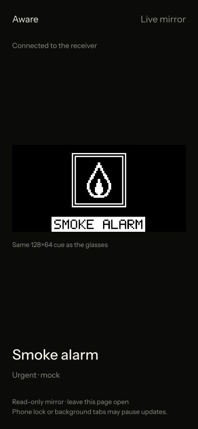

# iPhone live alert mirror

Shows the authoritative receiver cue with the same 128×64 renderer, labels, compass arrow and
acknowledgement check. It does not own settings, run inference, access a camera or dismiss alerts.
This is an alert viewer, not phone camera streaming. For iPhone POV, use
[Continuity Camera](iphone-camera.md); that locks the phone, so use the laptop to view alerts. Opening it never auto-starts a microphone.

## Run on the processing Mac

1. Start the receiver as usual. Note its port (8765 by default; Emma's current session uses 8766).
2. `npm ci --prefix frontend` then `npm run build --prefix frontend`.
3. Get the Mac's Wi-Fi address: `ipconfig getifaddr en0` (interface may differ on another Mac).
4. Start `python3 scripts/phone_mirror.py --host YOUR_WIFI_IP --receiver http://127.0.0.1:8765`.
5. Copy the printed access link to Safari on the iPhone, on the same trusted Wi-Fi.
6. Use **Receiver** mode on the laptop companion. Browser-only test sounds are local and do not reach
   another device. Send a mock sound through the receiver, then verify both screens together.

The viewer listens on port 5176. A random access key is required; it becomes an HttpOnly session
cookie after opening the link. The link expires when the viewer process stops. All writes and all
receiver endpoints except GET /state are blocked. Do not publish the access link or commit it.
This local HTTP connection is unencrypted; use only a trusted demo network. No public tunnel is
created. Keep the receiver bound to localhost. Stop the viewer with Ctrl+C when done.

Venue Wi-Fi may isolate devices. If Safari cannot open the link, first confirm the Mac IP and
network, then use a team-controlled network that permits communication between these devices.
Do not bypass browser security warnings. A camera connection would be a separate task.

## Tested / remaining

- Build passes; browser at 390px shows mock Smoke alarm from the live receiver.
- HTTP integration test checks required access key, session cookie, readable state and blocked writes.
- Polls every 250ms after each response; clears cue on connection failure and retries automatically.
- Actual iPhone Safari / venue network trial remains pending. Test reload, rotation, background/resume,
  receiver offline/reconnect and matching Dismiss acknowledgement from the laptop.
- Keep Safari foregrounded and phone awake during the demo. Backgrounding may suspend updates.
- Ordinary OS/network scheduling means displays can differ by a polling interval; no frame-sync claim.

