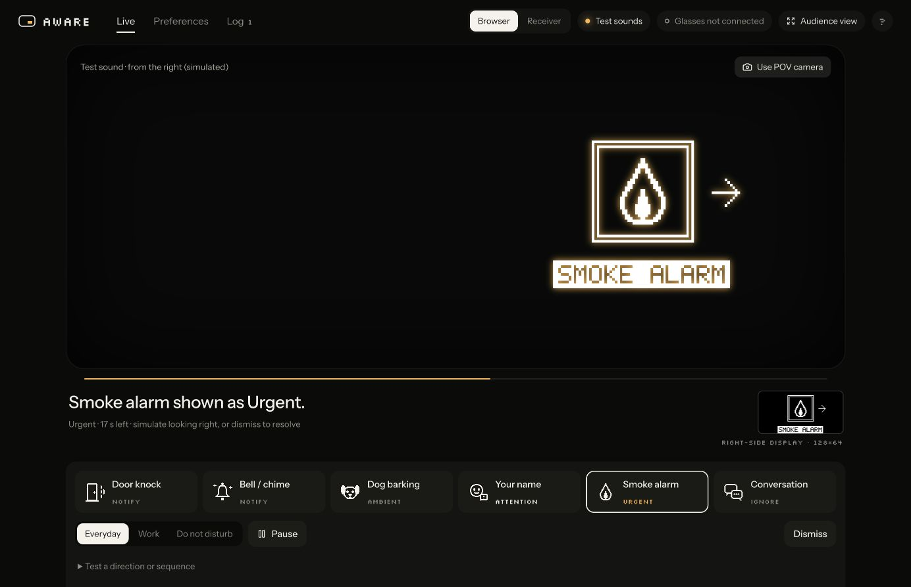
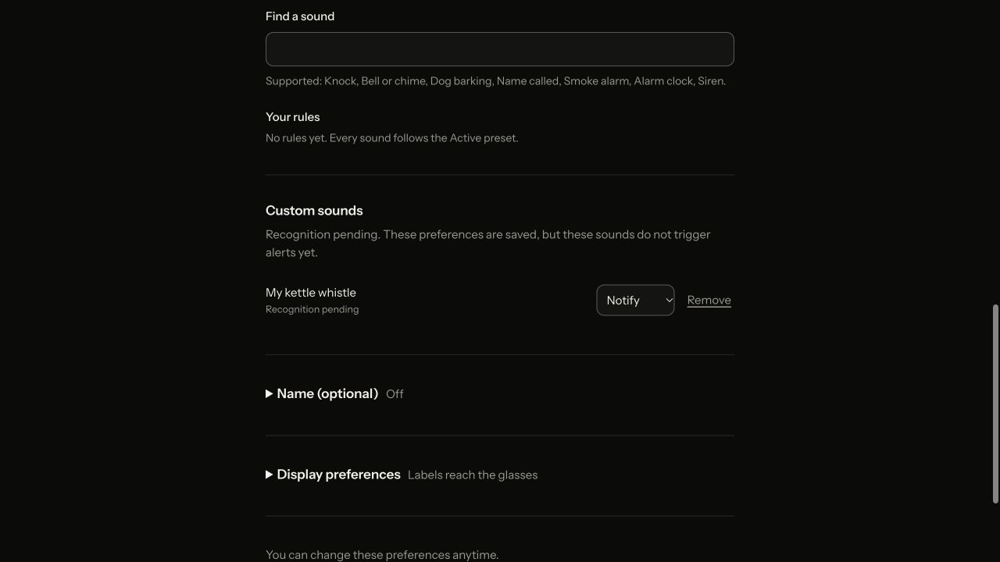

# Simulator / backend checkpoint — October 24

Freeze candidate for Emma's D + E roles. Focus future changes on integration fixes and physical
calibration, not another visual redesign. See [integration revisit list](integration-revisit.md).

## D — backend / priority

| Requirement | Status |
| --- | --- |
| Lock event JSON with hardware/ML/UI owners | Versioned implementation/docs exist; team sign-off still required |
| Fake generator + receiver + shared delivery | Implemented; browser and display clients poll the authoritative receiver |
| Five tiers, category inheritance, per-sound overrides, presets | Implemented in both engines; override → category → preset → legacy producer fallback |
| Ordering, interruption, duration, repeats, cooldown, unknown direction | Implemented; shared timeline and stress tests |
| Onboarding profile load/save | Browser-local save and validated atomic receiver persistence implemented |
| Matching laptop/glasses output | Exact software raster parity; actual OLED still awaiting physical validation |
| Verified location/proximity rules | Deferred until trusted sensor input exists |

Category overrides are optional under Category defaults. Individual sound overrides always win.
Custom labels are saved as `custom_sound_requests` metadata with `status: pending`; they never become
detector event types or live alerts just because they were typed. Requests persist across browser and
receiver restart. Maximum 20 pending requests, 80 characters per label, numeric tiers 0–4.

## E — interface / onboarding / POV

| Requirement | Status |
| --- | --- |
| Five-tier icon/label/timing vocabulary | Implemented; Pause explicitly hides alerts including Urgent |
| Exact panel dimensions | Shared 128×64 pixel renderer; 127 browser/Python fixtures |
| Responsive keyboard-usable onboarding | Implemented; names/aliases, suggestions, exceptions, category settings and pending custom sounds |
| Judge POV + diagnostics | Live view, audience view, source labels, reasons and log implemented |
| Fake stream/preferences integration | Implemented; receiver path also exercised with replay/mock inputs |
| Supported spatial cues | Four compass directions supported; real localization is not running |
| Camera gestures | Opt-in demo-camera thumbs-up; user reports finicky. Tuning deferred; physical glasses have no camera |

The physical display is on the **right side of the field of vision**. The icon remains centered
inside the panel; arrows around it communicate front/right/behind/left. No measured direction means
no arrow. The browser's right-side patch illustrates location, not a measured optical FOV size.

Demo controls are collapsed by default. Everyday/Work/DND, Pause and Dismiss stay visible. One alert
appears at a time; other arrivals can queue and the log explains decisions.

## Demo gesture steps

1. Live → Use POV camera (a camera visible to this browser, e.g. laptop webcam).
2. Enable thumbs-up; wait for the model to load.
3. Play an alert with your hand down, then hold a thumbs-up for about 0.5 seconds.
4. A successful dismissal shows a check mark. Lower your hand for at least 0.25 seconds to re-arm.

The gesture uses an exact event ID, a hold/release latch, cooldown and new-video-frame checks. A held
hand spanning a cue change cannot dismiss the replacement. The model is dynamically loaded only when
enabled. Model/WASM assets are prepared locally during dev/build; fresh setup may require a download.
Manual Dismiss remains the reliable fallback. See [Google's gesture guide](https://developers.google.com/edge/mediapipe/solutions/vision/gesture_recognizer/web_js).

## Verification

- Production build; 18 frontend tests; 43 Python tests; 18 shared alert scenarios.
- 127 raster fixtures regenerated for the centered compass layout, including Unicode/long labels.
- 10,000-action cross-language regression after these changes; previous 150,000-action stress run
  is recorded in the overnight report (simulated hours, not device uptime).
- Browser: pending custom label created, persisted through reload, removed; category inheritance
  changed the visible sound priority; centered compass appeared in both previews.
- Real-hand trial: Emma reports finicky gestures; not signed off as reliable.
- Phone viewer implemented; authenticated LAN/browser trial passed at 390px. Real iPhone Safari trial pending.
- Real OLED, calibrated optics and final-room recognition are not signed off.

Use one settings-owning companion until cross-client conflict handling is added. The receiver on
8766 was restarted with current code; previous profile was backed up locally. A reused QA origin
briefly auto-synced its old preset; the backed-up receiver profile was then restored.

