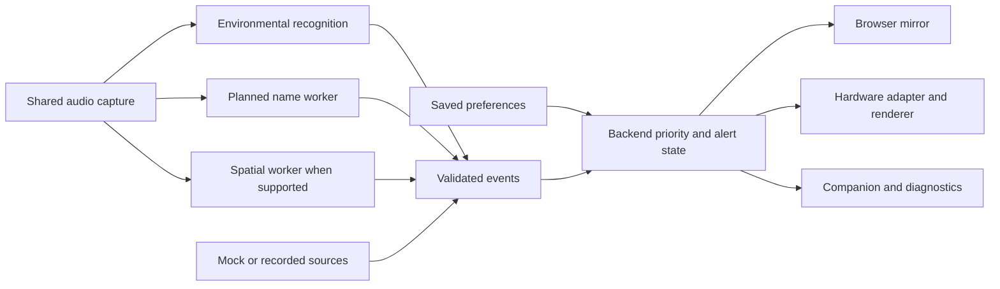

# Browser mirror, companion, and backend plan

Status: implementation plan; the polished frontend and backend extensions below are **not built yet**.
Owner: Emma, UI/UX first, then backend/integration. Hardware: Yameen. Other owners remain team-assigned.
Track execution in the [master TODO](../TODO.md). Existing handoffs remain linked from the [README](../README.md).

## Demo we are building

A judge wears the glasses. Someone makes a sound. The judge sees a concise cue, and the audience
sees the same active cue on a beautiful browser mirror. An operator can configure the experience,
inspect recent events, and run clearly labeled mock or recorded demonstrations.

The browser preview establishes the icon vocabulary, labels, and behavior. It is not HTML that we
can automatically copy onto any OLED: the hardware needs its own renderer, sized to its actual
pixels, contrast, refresh rate, and optics. Both renderers consume **one authoritative alert state**.
Hardware uncertainty does not block browser work; direction and distance remain unknown until measured.



## Screens and experience

| Surface | Content | Acceptance criterion |
| --- | --- | --- |
| Audience mirror | Large glasses cue, restrained source/status indicator, fullscreen | Audience understands the sound immediately; matches active hardware event |
| Companion | Glasses preview, connection status, recent alerts, settings, dismiss | Operator can run the demo without a terminal once control APIs exist |
| Setup/settings | Optional name and aliases, sound preferences, notification mode, cue preview | Saved choices change behavior and remain editable |
| Diagnostics | Model scores, rule reasons, timestamps, worker health, delivery errors | Teammates can investigate a missed or confusing cue without crowding the mirror |

The mirror and companion are two views of the same session, not two competing versions of the
product. The audience mirror has no raw JSON or confidence percentages. Diagnostics retain the
existing decision logs. Keep simulation controls in the companion and label every source honestly.

Visual direction: ink/graphite surfaces, strong typography, generous spacing, precise icons, and
one restrained accent. The cue itself stays monochrome-compatible. Use custom layouts and tokens
so the result feels designed; reserve motion for gentle cue entrance/exit and respect reduced motion.
Readable text and icons convey urgency even without color. No flashing or unsupported direction arrows.

### Shared cue vocabulary

| Tier | Proposed browser treatment | Current receiver lifetime |
| --- | --- | --- |
| 0 — ignored | No active cue; decision visible in diagnostics | None |
| 1 — ambient | Small peripheral icon and short label | 2 seconds |
| 2 — attention | Clear icon and short label | 3 seconds |
| 3 — important | More prominent cue, e.g. “Your name” | 5 seconds |
| 4 — urgent | Strongest framing and persistent prominence; explicit dismiss | Up to 30 seconds |

These are five tiers numbered **0–4**, with four visible treatments. Preserve current lifetimes
initially; change them only after readability tests. Hardware treatments depend on its resolution.
The preview must cover idle, all tiers, unknown direction, paused, disconnected, reconnecting, and
unavailable capabilities. A simulated direction must be labeled as such.

## Build order and review checkpoints

Timeboxes below are targets after UI implementation starts, not claims of completed work.

1. **Contract and visual foundation (~30 minutes).** Agree on tier meanings, labels, icon IDs,
   mock/replay/live badges, and screen layout. Create typography, spacing, contrast, and motion tokens.
   Freeze the small shared interfaces before teammates build adapters.
2. **Mirror and glasses preview (~60–90 minutes).** Build a single reusable browser cue renderer
   and a mock source. Include every tier, long labels, rapid events, interruption, unknown direction,
   idle and disconnected states. Review fullscreen at audience distance. First UI deliverable is
   a polished alert experience, before onboarding.
3. **Connect the existing receiver (~30–60 minutes).** Read `GET /state` through an adapter and
   send dismiss actions. Show existing fake and recorded events in the new mirror. Keep the old
   monitor available for debugging. This checkpoint must happen before spending hours polishing setup.
4. **Companion and short setup (~60–90 minutes).** Add event history, labeled demo scenarios,
   editable preferences, and optional typed name/aliases. Use mock profile storage until the backend
   profile API lands; visibly distinguish draft settings from applied settings. Name recognition may
   be unavailable, even when its configuration form is ready.
5. **Backend integration.** Implement the profile contract, authoritative preference mapping,
   worker status, interruption/queue behavior, and real controls in small PRs. Swap the frontend
   adapter to the implemented APIs. Verify settings survive restart and actually affect emitted cues.
6. **Physical display and final audio.** Once Yameen supplies the stack, implement the hardware
   adapter, verify matching event IDs, test readability through the optics, then retest the final
   microphone/room. Integrate names and measured direction when their workers are ready.
7. **Rehearsal.** Run a live sound, recorded fallback, urgent interruption, dismiss, reconnect,
   name demonstration, and an honest unknown-direction case. Measure full sound-to-display latency.

At the first UI checkpoint, a mock event must look excellent. At the second integration checkpoint,
one recorded sound must reach that same UI automatically. Physical display work proceeds in parallel.

## Frontend structure

Proposed stack: React + TypeScript + Vite, accessible shadcn/Radix controls, and Lucide SVG icons.
These provide reusable components while leaving layout and visual design under our control.
See the official [Vite guide](https://vite.dev/guide/), [shadcn documentation](https://ui.shadcn.com/docs),
[Radix introduction](https://www.radix-ui.com/primitives/docs/overview/introduction), and
[Lucide guide](https://lucide.dev/guide/). Select and lock compatible versions when scaffolding.

Proposed new directory, without reorganizing the Python package:

```text
frontend/src/
  app/                 # companion, mirror, setup, diagnostics views
  components/hud/      # browser cue renderer and icon mapping
  components/ui/       # accessible controls
  contracts/           # versioned API types and null-safe parsers
  adapters/            # mock and existing Python HTTP implementations
  scenarios/           # deterministic demo timelines and fixtures
  styles/              # design tokens and global styles
```

Use a development proxy to the loopback Python receiver on port 8765. Start with the existing
250 ms state polling; streaming is optional after the core flow works. Browser views never each
run their own priority algorithm. No cloud account, database, or login is needed for this local demo.

The adapter isolates transport changes, not different product behavior. Mock scenarios use the same
view-model shape as real state, with explicit source labels. Do not automatically replay stale alerts
after reconnect. Disable unavailable controls rather than pretending they affect the workers.

## Backend contract and behavior

Everything marked **proposed** requires implementation and coordinated contract review.

| Interface | Current status | Required change |
| --- | --- | --- |
| `POST /events` | Implemented, environmental v1 events | Keep compatibility; deduplicate event IDs and validate future fields |
| `GET /state` | Implemented: active, recent events, decisions | Add versioned presentation state, sequence, expiry, and freshness metadata |
| `POST /dismiss` | Implemented: clears active cue | Add expected event ID so a stale click cannot dismiss a newer urgent cue |
| `GET /profile`, `PUT /profile` | Proposed | Validate and atomically persist local settings with revision |
| Health/capabilities endpoint | Proposed | Report receiver, capture, classifier, name, spatial and display status separately |
| Pause/resume control | Proposed | Control actual worker processing; acknowledge state back to UI |
| Hardware state transport | Pending hardware | Deliver canonical active state, clear, expiry and reconnect snapshot |

Suggested presentation state adds `state_sequence`, active `event_id`, `effective_tier`, `icon_id`,
short label, optional measured direction, source, and remaining lifetime. This is an output envelope,
not an immediate breaking change to recognizer JSON. Preserve existing `active/events/decisions`
until all clients migrate. The hardware adapter converts this envelope into device-specific commands.

Timing authority belongs to the backend. Use monotonic time internally; clients receive a remaining
lifetime with freshness metadata so they do not compare unrelated device clocks. Both displays must
clear on expiry and handle stale connections explicitly. A disconnected display must not indefinitely
retain a cue. Agree on a measured mirror/display skew budget after the transport is known.

### Preferences and names

Start from the [proposed profile](onboarding-profile.example.json) and
[name implementation plan](name-detection-plan.md). Agree on these details before wiring forms:

- Mode selects defaults; `event_tiers` contains explicit user overrides. Do not save every default as
  an override, or changing modes will appear to do nothing.
- If sound enable/disable controls are included, add a documented versioned field; the current
  example does not define one. Keep one source of truth for saved preferences.
- Backend computes effective tier from event type, mode and override. Existing producer tiers are
  legacy defaults during migration. Preferences do not change classifier weights.
- Typed name and aliases configure the planned speech worker. Configuration readiness and worker
  readiness are separate. No claim that a name was recognized until a worker actually emits it.
- Future name events may have nullable confidence. Update validation and UI together; never call
  numeric formatting methods on a missing score. Raw speech is not needed in the audience mirror.

### Alert ordering and worker controls

Current behavior replaces an alert with an equal/higher tier and drops lower-priority display
requests. It does **not** queue them. Proposed initial queue policy: cap at five pending events;
drop tier-1 interruptions, retain tier-2/3 only while fresh (initial target ten seconds), and let tier 4
interrupt immediately. Prefer the latest equal-tier event; consolidate repeated detections of an
ongoing sound. Validate these choices with a scripted timeline before adopting them.

Test knock → name → smoke alarm → dismiss, repeated alarms, stale queued events, duplicate IDs,
and reconnect. Dismiss acknowledges the current cue; a new valid urgent detection can alert again.
Keep recognition cooldowns separate from display lifetime and user preferences.

Receiver connectivity does not mean the microphone is listening. Capture and inference heartbeats
must remain healthy during silence. Pause must actually affect processing and clear stale buffers;
a hidden UI cue alone is not pause. Record control failures and delivery failures in diagnostics.

Retain recognition decisions and alert decisions as separate logs. For bell/alarm ambiguity, show
the recent context and suppression reason; the existing four-second alarm-context hold is useful
evidence, not a guarantee that every bell-like sound was an alarm.

## Team handoffs and merge order

- Emma owns frontend first, then shared backend integration. Yameen owns hardware. Confirm who
  owns name recognition and spatial work; GitHub collaborator access does not assign these roles.
- UI can develop mock views while ML emits v1 events and hardware displays fake cues. Avoid
  simultaneous uncoordinated edits to `audio/events.py`, `audio/server.py`, and profile schemas.
- Merge small PRs: contracts/fixtures → mirror → receiver adapter → companion/setup → backend
  settings/state → hardware adapter. ML and spatial worker PRs integrate against agreed interfaces.
- Each PR updates relevant [TODO IDs](../TODO.md), includes screenshots or behavioral evidence,
  and notes schema/dependency changes. “Planned” is never “implemented.”

## Hardware information still needed

Compute device/OS; controller; display model, pixel dimensions and driver; audio device/interface;
native sample rate, channel order/count and synchronization; alert/audio transport; available controls;
whether the laptop remains connected during the demo. If Quest 3 is selected, verify its actual
capture/display APIs before choosing those adapters. Preserve synchronized multichannel audio for
spatial work while feeding normalized mono audio to environmental recognition.

No additional visual preference is required to start the first UI build. Hardware details gate physical
rendering and localization, not the browser mirror, settings design, or event integration.
