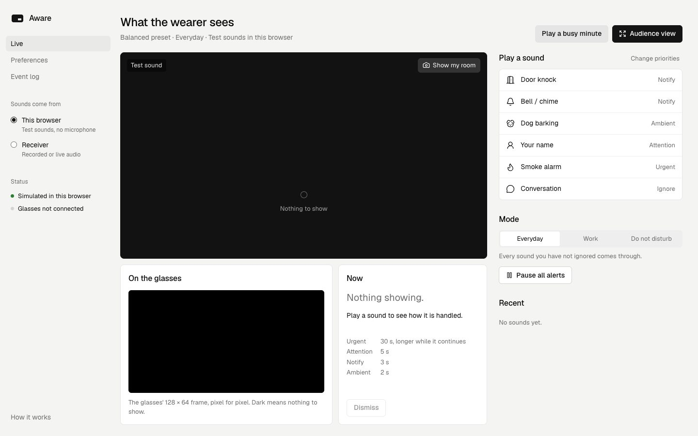

# Browser companion and audience mirror

Local React/TypeScript/Vite frontend. **Aware** is a working UI title, not a finalized product name.
No account, cloud deployment, microphone permission or model download is needed for the simulator.

## Run

Use Node.js **22.12+** (Node 22.23.2 tested). From the repo root:

```sh
npm ci --prefix frontend
npm run dev --prefix frontend
```

Open http://127.0.0.1:5173. The development server binds only to the local computer.

Judges land on **Live**: the wearer's view (optionally your room through the camera), the exact
128×64 frame the glasses draw, a Now panel with time left and the reason for the last decision,
the sounds with their current priority, Everyday/Work/Do not disturb and Pause.

- **This browser:** test sounds run through a port of the receiver's engine (same rules, tested
  against the same scenarios). Each sound button starts fresh; **Play a busy minute** shows
  interruption, skipping, merging and (after Dismiss) a waiting cue coming back.
- **Audience view:** the stage alone for a projector, with the glasses frame and reason line.
- **Preferences:** Mana onboarding. Saved in the browser and pushed to the receiver when connected.
- **Event log:** every decision with its outcome and reason; raw JSON under a disclosure.

## Connect existing recognition

Start the Python receiver in another terminal:

```sh
python3 -m audio.server
```

In the sidebar choose **Receiver**. Vite proxies `/api/*` to `AWARE_RECEIVER`
(default `http://127.0.0.1:8765`). The receiver owns priority and timing; the companion pushes your
preferences to it, sends controls and dismisses, and shows glasses connection from `/health`.
See [alert engine and receiver API](../docs/alert-engine.md).

Send mock events without a model:

```sh
python3 -m audio.cli fake knock
```

Or, after the [audio setup](../docs/audio-guide.md), replay an existing recording:

```sh
.venv/bin/python -m audio.demo --event smoke_alarm --exit-after-demo
```

This replay does not start a microphone. Microphone capture remains an explicit separate action.
Conversation stays disabled in Receiver mode (no detector). Receiver sound buttons inject
**test** events, not classified audio; the stage caption shows each cue's real source.

## Implementation boundaries

- `src/lib/alerts.ts`: browser port of `audio/alerts.py`; `src/lib/session.ts` hides whether the
  browser engine or the receiver is in charge.
- `src/lib/explain.ts`: one sentence per decision reason.
- `src/lib/oled.ts` + `src/components/Oled.tsx`: port of `hardware/display.py`'s renderer.
- `src/components/Stage.tsx`: wearer's view with the click-to-start camera; `Cue.tsx`: the cue.
- `src/App.tsx`: shell, Live, Preferences, Event log, audience view.
- `src/styles.css`: tokens from `.taste-skill/direction.json` (Geist, ink chrome, one data hue).

Polling has cancellation, timeout and no overlapping requests. A receiver failure clears the visible
cue and marks the connection lost; it reconnects automatically and the receiver's state wins (a
restarted receiver never replays an old cue). Separate browser tabs in "This browser" mode have
independent simulated state.

## Verify

```sh
npm run build --prefix frontend
npm test --prefix frontend
```

Verified October 23: production build; shared engine scenarios; preset parity with onboarding;
explanation coverage; byte-identical glasses frames; parser/HTTP failure cases. In the browser:
preferences → receiver → glasses client, Work/DND/pause, dismiss and resume, receiver kill and
restart, 1440/768/375 layouts, keyboard focus, audience view, camera via a synthetic stream.
The physical display and final room microphone remain untested.



The [display UX notes](../docs/display-ux.md) explain defaults/search, icon-first cues and the optical
questions for Yameen. The [alert engine doc](../docs/alert-engine.md) covers the rules, API and Pi bring-up.

## Current camera scope — October 24

The glasses have no camera. **Use POV camera** adds a demo backdrop from a browser-visible webcam
(laptop, or a phone exposed by the OS as a webcam). It does not provide wearable gesture/head tracking.
Camera video stays in the tab. Hand recognition is not loaded or run by the current app, and dev/build
no longer downloads its model. The unused experimental code remains available for future evaluation.
A direct remote phone-browser feed is not configured; laptop localhost is not a phone-accessible site.
