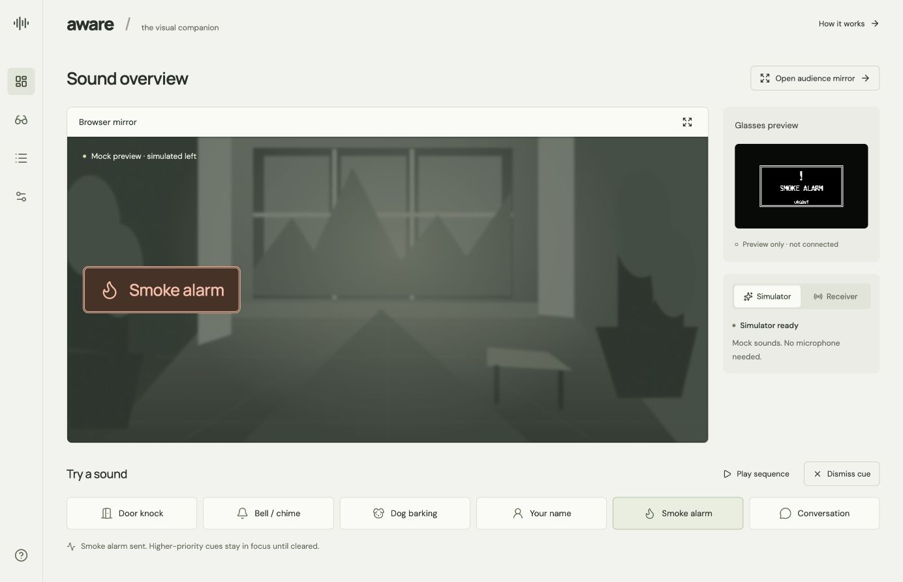

# Browser companion and audience mirror

Local React/TypeScript/Vite frontend. **Aware** is a working UI title, not a finalized product name.
No account, cloud deployment, microphone permission or model download is needed for the simulator.

## Run

Use Node.js **22.12+** (Node 22.23.2 tested). From the repo root:

```sh
npm ci --prefix frontend
npm run dev --prefix frontend
```

Open http://127.0.0.1:5173. The development server binds only to the local computer.

- **Simulator:** try sound buttons or the scripted interruption sequence. All events are mock.
- **Audience mirror:** expands the same active cue; Escape returns to companion view.
- **Preview preferences:** uses presets and searchable exception rules for the current page session, not saved/live profiles. Display options preview icon-first cues, colors and mock direction.
- **Event log:** shows arrivals, priority outcomes and optional developer JSON.
- **OLED:** exact 128×64 one-bit raster design preview, not a connected physical display.

## Connect existing recognition

Start the Python receiver in another terminal:

```sh
python3 -m audio.server
```

If port 8765 is already occupied by this receiver, reuse it. In the UI select **Receiver**.
Vite proxies `/api/*` to loopback port 8765; no CORS change or public exposure is required.
The receiver owns priority and timing. It does not report microphone/worker health yet.

Send mock events without a model:

```sh
python3 -m audio.cli fake knock
```

Or, after the [audio setup](../docs/audio-guide.md), replay an existing recording:

```sh
.venv/bin/python -m audio.demo --event smoke_alarm --exit-after-demo
```

This replay does not start a microphone. Microphone capture remains an explicit separate action.
Names and conversation buttons are disabled in Receiver mode because the current backend does
not accept those types. Receiver sound buttons inject **mock** JSON, not classified audio.

## Implementation boundaries

- `src/lib/events.ts`: v1 input parsing, HTTP adapter, fixtures, browser-only mock selection.
- `src/components/Cue.tsx`: shared audience/browser cue.
- `src/components/Oled.tsx`: exact pixel dimensions and one-bit thresholding. Final firmware fonts,
  icons, optical inversion and layout still require hardware testing.
- `src/components/Scene.tsx`: code-native simulated environment, not a camera feed.
- `src/App.tsx`: session controls, sequential polling, source selection and screens.
- `src/styles.css`: responsive layout, design tokens, reduced-motion support.

Polling has cancellation, timeout and no overlapping requests. A receiver failure clears the visible
cue and marks the connection lost. It reconnects automatically; the server's current state wins.
Independent browser simulator tabs have independent mock state; this pass does not claim multi-client
synchronization. Fullscreen mirror uses the current page/session. Hardware is always marked disconnected.

Future backend work: authoritative saved preferences, event-specific dismiss (current receiver clears
whatever is active), fresh state sequence/expiry, worker health, Pi bridge and shared capture.
See [TODO](../TODO.md) and [UI/backend plan](../docs/ui-ux-backend-plan.md).

## Verify

```sh
npm run build --prefix frontend
npm test --prefix frontend
```

Verified in this pass: production build; priority/expiry/dedup/parser/HTTP failure unit cases;
browser urgent interruption, receiver connection, labeled-recording inference → mirror, OLED cue,
audience expansion and dismissal. The physical display and final room microphone remain untested.



The [display UX notes](../docs/display-ux.md) explain defaults/search, icon-first cues, mock peripheral positioning, monochrome limits and the optical questions for Yameen. The offline [device renderer](../docs/display-renderer.md) is a separate implementation; it is not connected to this preview yet.
